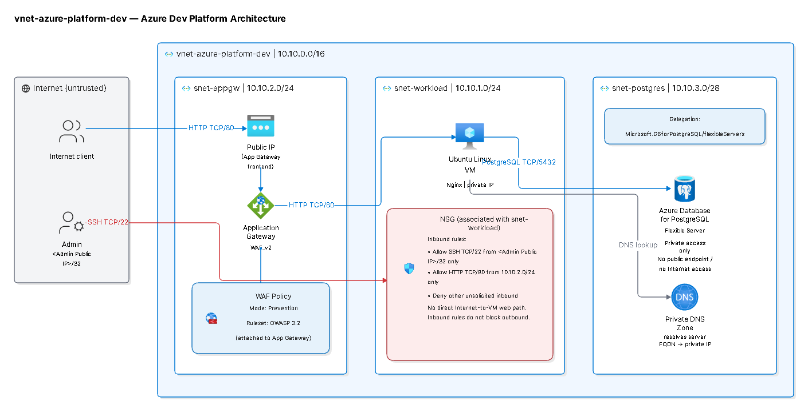

\# Secure Automated Multi-Tier Cloud Infrastructure on Azure

A Terraform-based Azure infrastructure project focused on secure networking, private application hosting, database connectivity, automation, and cloud monitoring.

\## Overview

This project aims to design and implement a secure, multi-tier cloud infrastructure on Microsoft Azure, following common enterprise cloud architecture principles.

The infrastructure separates the application and database tiers into dedicated subnets, exposes the application through Azure Application Gateway with Web Application Firewall (WAF), and restricts database connectivity to private network access.

Infrastructure provisioning is managed using \*\*Terraform\*\*, with the planned addition of containerization, CI/CD automation, identity-based authentication, and centralized monitoring.

\## Architecture

\### Network architecture

| Component | Configuration |

|---|---|

| Virtual Network | `vnet-azure-platform-dev` |

| Address Space | `10.10.0.0/16` |

| Application Gateway Subnet | `snet-appgw` — `10.10.2.0/24` |

| Workload Subnet | `snet-workload` — `10.10.1.0/24` |

| PostgreSQL Subnet | `snet-postgres` — `10.10.3.0/28` |

\### Application tier

\- Azure Application Gateway WAF\_v2 provides the public entry point.

\- A WAF Policy operates in Prevention mode with OWASP 3.2 rules.

\- An Ubuntu Linux virtual machine hosts Nginx in the private workload subnet.

\- Network Security Groups restrict inbound access to authorized traffic.

\- SSH access is restricted to an administrator public IP address.

\### Database tier

\- Azure Database for PostgreSQL Flexible Server.

\- Dedicated subnet with `Microsoft.DBforPostgreSQL/flexibleServers` delegation.

\- Private network access without a public endpoint.

\- Private DNS resolution for database connectivity.

\- PostgreSQL traffic uses TCP port `5432`.

\### Traffic flow

1\. Internet clients connect to the Application Gateway public IP.

2\. Application Gateway inspects incoming traffic through WAF.

3\. Approved HTTP traffic is forwarded to the private Ubuntu VM.

4\. The application connects to PostgreSQL through private networking and DNS resolution.

There is no direct public internet access to the workload VM or PostgreSQL server.

\## Technology Stack

| Category | Technologies |

|---|---|

| Cloud Platform | Microsoft Azure |

| Infrastructure as Code | Terraform |

| Networking | Azure VNet, Subnets, NSGs, Private DNS |

| Compute | Ubuntu Linux Virtual Machines |

| Web Gateway | Azure Application Gateway, WAF\_v2 |

| Database | Azure Database for PostgreSQL Flexible Server |

| Containers | Docker |

| Container Registry | Azure Container Registry (ACR) |

| CI/CD | GitHub Actions |

| Identity and Security | Microsoft Entra ID, Managed Identity, OIDC, Azure RBAC |

| Monitoring | Azure Monitor, Log Analytics, KQL |

| Version Control | Git, GitHub |

\## Infrastructure Automation

Terraform is used to define and provision Azure resources through reusable infrastructure configuration.

The infrastructure code is organized into separate configuration files to make the deployment easier to maintain and extend.

The intended workflow is:

1\. Define infrastructure resources using Terraform.

2\. Validate configurations with `terraform validate`.

3\. Review infrastructure changes using `terraform plan`.

4\. Deploy resources using `terraform apply`.

5\. Manage infrastructure lifecycle through Terraform.

\## Containerization and CI/CD

The application tier is designed to support containerized deployment using Docker.

The planned delivery workflow includes:

\- Building application Docker images.

\- Publishing images to Azure Container Registry.

\- Automating application build and deployment through GitHub Actions.

\- Automating Terraform validation and infrastructure deployment.

\- Using OIDC and Azure identity-based authentication instead of storing long-lived Azure credentials in GitHub.

\## Monitoring and Security

The project incorporates monitoring and security controls as part of its target architecture.

Planned capabilities include:

\- Azure Monitor for infrastructure monitoring.

\- Log Analytics Workspace for centralized log collection.

\- KQL queries for log analysis.

\- NSG rules for network traffic control.

\- WAF protection for public application traffic.

\- Private database connectivity.

\- Managed identities and least-privilege Azure RBAC.

\## Project Implementation Status

The project is being developed incrementally to control resource usage and avoid unnecessary Azure costs.

The Terraform foundation has been initialized. Networking, compute, application gateway, database, containerization, automation, and monitoring are being developed and validated in successive implementation stages.

The architecture diagram represents the intended overall design; it should not be interpreted as proof that every component is currently deployed.

\## Cost Management

Azure resources are provisioned selectively during implementation and testing.

Expensive resources, particularly Application Gateway WAF\_v2, are not intended to remain running when they are not required.

Terraform is used to manage resource creation and destruction, helping limit unnecessary consumption of the Azure for Students credit.

\## Repository

The project is maintained in GitHub, with infrastructure configuration, architecture documentation, and supporting implementation evidence organized in the repository.

\---

\*\*Project:\*\* Secure Automated Multi-Tier Cloud Infrastructure on Azure  

\*\*Cloud Provider:\*\* Microsoft Azure  

\*\*Infrastructure as Code:\*\* Terraform

